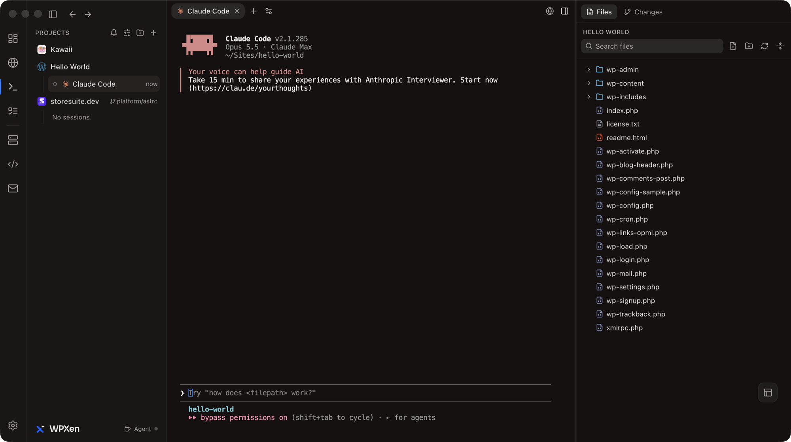
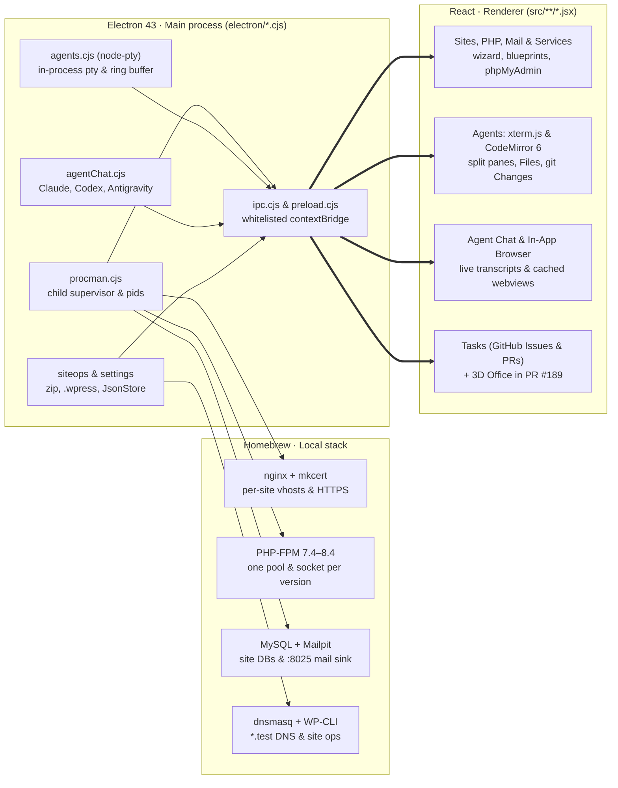

# Case study: WPXen

**A macOS Menu-Bar App for Local WordPress Sites and AI Coding Agents**

Between June and October 2026 I built [WPXen](https://aminurislam.me/wpxen), a native macOS menu-bar app that supervises Homebrew nginx, PHP-FPM, MySQL and Mailpit for `.test` WordPress sites and hosts AI agent terminals, a live transcript chat view, a file editor, a git diff pane and an in-app browser beside each site. I made **all 292 non-merge commits** on `develop`, working with Claude Code as my pair (264 carry a Claude co-author trailer). Eight releases from `v1.0.0` to `v1.5.0` are published on [GitHub](https://github.com/aminurislamarnob/WPXen/releases) as Apple Silicon and Intel DMGs.

|              |                                                                                                      |
| ------------ | ---------------------------------------------------------------------------------------------------- |
| **Role**     | Creator and developer, with Claude Code as pair                                                      |
| **Team**     | 1 developer, 1 repository                                                                            |
| **Window**   | 26 Jun to 27 Oct 2026 (`develop`, Asia/Dhaka)                                                        |
| **Releases** | `v1.0.0` to `v1.5.0` on GitHub, product page at [aminurislam.me/wpxen](https://aminurislam.me/wpxen) |
| **Stack**    | Electron 43, React, Vite, Tailwind CSS, `node-pty`, xterm.js, CodeMirror 6, Homebrew, Vitest         |

## The months (26 Jun to 27 Oct)

Work on `develop` landed in four stretches:

- **26 June to 7 July (62 commits):** the local WordPress stack (`procman.cjs`, PHP switcher, mkcert HTTPS, Mailpit, Cloudflare share tunnels, magic login, `.zip` exports, blueprints and the `.wpress` reader).
- **23 to 28 July (56 commits):** the Agent Launcher, in-process `node-pty` sessions, file explorer, CodeMirror editor, git Changes pane, Superset design system, global settings and in-app browser tabs.
- **20 to 21 August (24 commits):** rebrand to WPXen, the Electron 28 → 43 upgrade, and one-click Agent CLI installers.
- **30 September to 27 October (150 commits):** Projects sidebar, session-status engine, keep-awake, Floating Workspace, GitHub Tasks (Issues, PRs, Projects v2), per-site PHP versions, releases `v1.1.0`–`v1.5.0`, split terminal panes, session handoff, and the 14-ticket Agent Chat View (#109, PR #173).

The branch was quiet from 8 to 22 July, from 29 July to 19 August, from 22 August to 29 September, and for two one-week stretches in mid-October.

**Totals on `develop`:** 292 of 292 commits (253 under my name and 39 committed from my Claude Code sessions; 264 carry a Claude co-author trailer), 63 of 63 merged pull requests, 94 GitHub issues, 1,229 passing Vitest tests (plus open integration branches PR #189 at 1,458 tests and PR #174 at 1,166 desktop + 75 mobile tests).

## The brief

From [README.md](../README.md) and [CLAUDE.md](../CLAUDE.md), WPXen is a macOS menu-bar app inspired by Laravel Herd that takes a Mac from a Homebrew installation to running `.test` WordPress sites and puts AI agents beside every site:

- **Use Homebrew, don't bundle binaries:** WPXen shells out to Homebrew formulae (`/opt/homebrew` on Apple Silicon, `/usr/local` on Intel) and offers to install missing formulae during onboarding.
- **Supervise services as children of the app:** [`procman.cjs`](../electron/services/procman.cjs) runs nginx, PHP-FPM, MySQL and Mailpit as child processes of WPXen instead of `brew services`, so they stay out of macOS "App Background Activity" and stop when the app quits. Only `dnsmasq` uses `brew services` because it binds port 53 as root.
- **Keep the renderer out of Node:** the React renderer has no `nodeIntegration` and talks to `electron/*.cjs` only through [`preload.cjs`](../electron/preload.cjs)'s `contextBridge` (`window.electronAPI`).
- **Host agent sessions in the main process without a daemon:** per [ADR 0001](../docs/adr/0001-main-process-pty-no-daemon.md), each Session's `node-pty` runs inside Electron's main process and survives the window hiding to the tray through an in-memory ring buffer.
- **Preserve user data across two renames:** the app shipped as WPHerd, then WPDevPilot, then WPXen. First launch migrates `Application Support` data and blueprints, imports old archive manifests, and replaces legacy `zz-*.ini`, mu-plugin and `/etc/sudoers.d/` files in place.

## Architecture

The codebase is plain JavaScript and JSX with no typechecker. Main-process modules under `electron/*.cjs` hold Node access and wrap CLI calls (`brew`, `mysql`, `wp`, `mkcert`, `git`, `gh`), while the renderer under `src/**/*.jsx` runs on React, React Router 6 and Tailwind CSS built by Vite. Every feature crossing the boundary registers an `ipcMain.handle` in [`electron/ipc.cjs`](../electron/ipc.cjs), exposes a wrapper and channel whitelist in [`electron/preload.cjs`](../electron/preload.cjs), and calls `window.electronAPI` from React.

Tests run in Vitest under plain Node with no DOM dependency. Because loading `electron` at module scope in Node triggers a ~100 MB binary download when `path.txt` is missing, [`test/no-module-scope-electron.test.js`](../test/no-module-scope-electron.test.js) enforces a ratchet that forbids top-level `require('electron')` outside five entry files, and main-process services expose `__setDeps()` seams for testing.

## The local stack (26 Jun to 7 Jul)

The first two weeks built the local WordPress stack. On 2 July I replaced `brew services` for nginx, PHP-FPM, MySQL and Mailpit with [`procman.cjs`](../electron/services/procman.cjs), a child-process supervisor with crash restart, backoff, graceful-stop escalation and PID-file orphan reconciliation after a hard crash.

- **One-click admin (magic login):** [`wordpress.cjs`](../electron/services/wordpress.cjs) writes a managed must-use plugin (`wp-content/mu-plugins/wpxen-magic-login.php`) that compares `$_GET['wpxen_magic_login']` against a per-site secret with `hash_equals`, sets the auth cookie for the chosen administrator, and refuses requests arriving over `.trycloudflare.com` share tunnels.
- **Shared archive engine:** [`siteops.cjs`](../electron/services/siteops.cjs) powers Export, Import, Clone and Blueprints. Export stages `database.sql`, `wpxen-manifest.json` and a `files` symlink to the site directory, then runs macOS `/usr/bin/zip` without `-y` so site files are streamed into the archive without copying them first.
- **All-in-One WP Migration (`.wpress`) reader:** [`wpress.cjs`](../electron/services/wpress.cjs) is a pure-Node reader for `.wpress` archives: 4,377-byte NUL-padded headers (`filename`, `size`, `mtime`, `directory`) followed by raw content blocks and an EOF terminator block. On import, `siteops.cjs` sniffs the table prefix from the SQL dump, requires at least two multisite tables before rejecting a multisite network, relaxes MySQL `sql_mode`, and restores active plugins and themes from `package.json`.
- **Per-site PHP and mkcert without sudo (30 Sep & 3 Oct):** [`mkcert.cjs`](../electron/services/mkcert.cjs) trusts its root CA in the user's login keychain (`TRUST_STORES=nss`) because a GUI app launched from Finder has no terminal for `sudo security add-trusted-cert`. [`php.cjs`](../electron/services/php.cjs) runs one supervised `php-fpm` child per installed version (`8.4` down to `7.4` via `shivammathur/php`, with `brew trust` for Homebrew 6) on its own Unix socket, and `agents.cjs` prepends the site's PHP keg to `$PATH` in its terminals.

## The Agents screen (23 Jul to 21 Aug)

From 23 to 28 July I built the Agents section alongside Sites. Each Site can run multiple concurrent AI CLI Sessions (`node-pty` instances keyed by `sessionId`) alongside a file tree, a CodeMirror 6 editor, a git Changes pane and an in-app browser.

In [ADR 0001](../docs/adr/0001-main-process-pty-no-daemon.md) I recorded the decision to host `node-pty` inside Electron's main process rather than in a Superset-style background daemon. Sessions survive the window hiding to the menu-bar tray and replay from an in-memory ring buffer when the window reopens; quitting WPXen confirms if Sessions are active and tears them down.

- **Superset design system (24 Jul):** replaced the earlier glass UI with Superset's flat, hairline-bordered design system ([`src/index.css`](../src/index.css)), where every colour resolves through semantic RGB tokens that flip with macOS `prefers-color-scheme`.
- **Files and git Changes (24 Jul):** the right-hand Explorer discovers nested git repositories inside a Site, shows git status decorations in the file tree, and provides Folders/Tree views, a unified diff viewer, and per-file stage, unstage and discard actions.
- **Launch Presets and Launch Targets (25 Jul):** global Launch Presets store default flags per Agent (`agentPresets`), while per-Site Launch Targets (`launchTargets`) pin a subfolder or git worktree and optional flag overrides.
- **In-app browser webview cache (26 Jul & 3 Oct):** because Electron reloads a `<webview>` whenever it is re-parented in the DOM, [`webviewCache.js`](../src/lib/browser/webviewCache.js) inserts each tab's `<webview>` once into a fixed layer at the end of `<body>` and positions it over the pane placeholder with CSS.
- **Electron 28 → 43 and CLI installers (20–21 Aug):** rebranded WPDevPilot to WPXen, upgraded Electron from 28 to 43 (switching dropped-file path resolution to `webUtils`), and added one-click Agent installers tagged by kind (`brew`, `npm` under the login-shell PATH, and `https`-only vendor `script` with fetch-then-run).

## Projects sidebar, Tasks and split panes (2 to 10 Oct)

Early October expanded the Agents workspace and shipped five point releases (`v1.1.0` through `v1.5.0`). On 2 October I added the VS Code-style ActivityBar, the Projects sidebar, and [`agentStatus.cjs`](../electron/services/agentStatus.cjs), which parses OSC title glyphs, terminal bells and exit codes from pty output to drive unread dots, native notifications (with a 5 s per-session cooldown) and the tray's "Agents needing attention" menu.

- **Keep Computer Awake (#43–#46, 2 Oct):** `On`, `Off` and `Agent` modes in the sidebar footer and tray menu, holding a power-save blocker while any Session is working.
- **Floating Workspace (#52–#57, 2 Oct):** an always-on-top companion window with persisted geometry, terminal tabs, browser tabs and markdown notes.
- **GitHub Tasks (#65–#75, 3 Oct):** an Issues list, PRs tab (conversation, file diffs and check rollups) and GitHub Projects v2 Board/Table view backed by the `gh` CLI, with a `Start →` action that checks out an issue or PR branch and launches an Agent on it.
- **Any folder or Git clone as a Project (3–10 Oct):** the Projects sidebar accepts non-WordPress folders and clones repositories directly into `~/Sites`.
- **Split terminal panes and session handoff (#103–#108, 10 Oct):** recursive horizontal/vertical terminal splits with saved ratios and nested sidebar rows, plus full or summarised session handoff to another Agent using a fenced read-this-file prompt in the source Session's working directory.

## Agent Chat View (#109, PR #173, 10 to 27 Oct)

From 10 to 27 October I worked on spec #109 (merged in PR #173 across 14 tickets, #110–#123): a per-pane toggle (`⌘⇧C`) between the live xterm terminal and a chat view that tails the Agent's own transcript file on disk while typing back into the TUI through a per-Session send serialiser.

| Agent                       | How the Session binds its transcript                                                      | What the decoder handles                                                                                                                                                                       |
| --------------------------- | ----------------------------------------------------------------------------------------- | ---------------------------------------------------------------------------------------------------------------------------------------------------------------------------------------------- |
| **Claude Code (#110–#113)** | Launched with `--session-id <uuid>` so the chat reads that exact `.jsonl` file            | `message.content` user turns, `ai-title` headers, folded tool runs, inline `Edit`/`Write`/`MultiEdit` diffs, nested subagent `.jsonl` tailing (#114), and `AskUserQuestion` cards (#116)       |
| **Codex CLI (#122)**        | Locates the matching rollout file in `~/.codex/sessions` by reading the first 64 KB       | Byte-offset fallback row IDs (real rollouts write no `payload.id`), deduplicating `event_msg` vs `response_item` copies, and stripping injected `AGENTS.md` and `<environment_context>` blocks |
| **Antigravity (#123)**      | Waits for a conversation created after Session start in `~/.gemini/antigravity-cli/brain` | Typed result steps, paired tool calls, diffs and notices without binding an older conversation from the same folder                                                                            |

As recorded in PR #173, the initial ticket implementations were drafted by subagents against invented fixture shapes and failed on real transcripts on disk. Across two review rounds (11 October and 27 October) I verified every ticket against real files and committed the fixes on top of the stack:

- **Closed an arbitrary-file read in the image IPC (#115):** the initial handler returned any file up to 5 MB under the temp dir, the site or `~/.claude` (including credentials) to a renderer-supplied path. I restricted it to `{ uuid, path }`, serving raster base64 blocks from an offset index of the Session's own transcripts.
- **Fixed silent decoder drops (#111–#123):** Claude user turns had read `record.content` instead of `message.content` (leaving every user message blank), Codex rendered 0 rows because real rollouts omit `payload.id`, and Codex's context meter read cumulative session tokens (showing 86% for ~12% in use).
- **Added `test/ipc-surface.test.js` and `test/real-transcripts.test.js`:** [`test/ipc-surface.test.js`](../test/ipc-surface.test.js) checks that every `window.electronAPI` method called in `src/` exists in `preload.cjs` and `ipc.cjs` (catching two unwired methods for `@` files and `/` commands). [`test/real-transcripts.test.js`](../test/real-transcripts.test.js) (opt-in via `WPXEN_REAL_TRANSCRIPTS=1`) runs every decoder and `Load older` to the top across the machine's real transcripts (361 Claude transcripts, 2 Codex rollouts and 54 Antigravity conversations on the review machine), raising the suite from 1,168 to **1,229 passing tests**.

## Open branches: the 3D Agent Office (#189) and Remote Access & Mobile (#174)

Two multi-ticket branches sit open on top of `develop`, each with its own review pass and test suite:

- **The 3D Agent Office (PR #189, `feat/178-office`, 28–29 Oct):** a one-time native port of my standalone `claude-agent-verse` project into WPXen (#178–#188, ADR 0002). Rather than embedding the standalone HTTP + WebSocket server, it upgrades WPXen to React 19 (#179) for React Three Fiber v9, runs the scanner, tailers and pure reducer in the main process, and replaces localhost HTTP bearer tokens with an owner-only `0600` Unix domain socket (`<userData>/wpxen-hook.sock`). Installing the optional Claude Code hook in Settings runs a `preview → confirm → apply` flow that diffs `~/.claude/settings.json`, pins the login-shell `node` binary's absolute path, writes `.bak` and `.tmp`, and atomically renames. Brings the branch to **1,458 passing Vitest tests**.
- **Remote Access & WPXen Mobile (PR #174, `feat/150-keep-awake`, 11–27 Oct):** implements spec #136 (#139–#150): a localhost server exposed through a supervised `cloudflared` tunnel, QR device pairing with an end-to-end encrypted WebSocket channel (protocol v2 using ephemeral X25519 keys, 32-byte nonces and SHA-512 key derivation via `tweetnacl`), and an Expo React Native companion app (`mobile/`) with a bundled xterm WebView under a `default-src 'none'` CSP. Two review rounds fixed a broken reconnect state machine, a Metro `tweetnacl` bundling failure, a replayable hello handshake, and sockets surviving device revocation (`ws.close` without `terminate()`). Tested by **1,166 desktop tests** and **75 mobile tests**; hardware tunnel and push checks remain open in #175.

## Details a visitor never sees

- **No-module-scope Electron ratchet:** [`test/no-module-scope-electron.test.js`](../test/no-module-scope-electron.test.js) forbids top-level `require('electron')` outside five entry files so running Vitest under plain Node never triggers Electron's ~100 MB binary download.
- **Optimistic settings with rollback:** [`settings.cjs`](../electron/services/settings.cjs) validates every patch against a typed schema; `useSettings.js` updates the UI immediately and rolls the value back if the side effect (such as an nginx reload or MySQL credential check) fails.
- **External URL gate:** [`safeUrl.cjs`](../electron/services/safeUrl.cjs) (`openExternalSafely`) is the single path out of the app and refuses any scheme other than `http:` and `https:`; in-app `<webview>` guests enforce the same check on `will-navigate` and `will-redirect`.
- **Two-generation rename shims:** `rebrand.cjs`, `siteops.cjs`, `php.cjs`, `mailpit.cjs`, `wordpress.cjs` and `sudoers.cjs` migrate state and clean up `zz-*.ini`, mu-plugin and `/etc/sudoers.d/` files left by both `WPDevPilot` and `WPHerd`.
- **Credential-safe directory scanners:** in PR #189, `scanner.cjs` reads only `*.json` in `~/.claude/sessions/` (skipping `.key` files) and `antigravity.cjs` opens only `.system_generated/logs/transcript.jsonl` so OAuth files under `~/.gemini` are never read.

## Working with Claude Code and subagents

264 of the 292 commits on `develop` carry a Claude co-author trailer, and 39 were committed directly from Claude Code sessions. [`CLAUDE.md`](../CLAUDE.md), [`AGENTS.md`](../AGENTS.md), [`CONTEXT.md`](../CONTEXT.md) and [`docs/agents/implementing-a-ticket.md`](../docs/agents/implementing-a-ticket.md) define the process split, the four-step CI gate (`lint` → `format:check` → `test` → `build:renderer`), the `__setDeps()` test seam, and the semantic token rules.

| What I directed and reviewed                                                                                             | What Claude Code and subagents drafted                                                                                 |
| ------------------------------------------------------------------------------------------------------------------------ | ---------------------------------------------------------------------------------------------------------------------- |
| Product scope, the two renames, and the architecture decisions (ADRs 0001 and 0002)                                      | Service wrappers (`procman.cjs`, `siteops.cjs`, `wpress.cjs`, `php.cjs`, `mkcert.cjs`)                                 |
| The Superset UI migration and the Electron 28 → 43 and React 18 → 19 upgrades                                            | Ticket implementations across Tasks (#65–#75), Chat View (#110–#123), Remote Access (#139–#150) and Office (#179–#188) |
| Spec-vs-code review passes on the stacked ticket PRs (#173, #174, #189)                                                  | Renderer components in `src/components/` and pure helpers in `src/lib/`                                                |
| Security and real-data fixes (the #115 image path read, protocol v2 E2EE, `0600` hook socket, atomic hook preview/apply) | Vitest unit and integration suites across `test/`                                                                      |
| Release packaging (`v1.0.0`–`v1.5.0`) and the landing page on `aminurislam.me/wpxen`                                     | Feature comparison research (`docs/research/lerd-feature-comparison.md`, `orca-feature-comparison.md`)                 |

## Where it stands

- **Eight shipped releases (`v1.0.0` to `v1.5.0`):** published on [GitHub Releases](https://github.com/aminurislamarnob/WPXen/releases) with Apple Silicon (`arm64`) and Intel (`x64`) DMGs.
- **Product page:** live at [aminurislam.me/wpxen](https://aminurislam.me/wpxen), kept in sync with releases through the repo's `.claude/skills/update-wpxen-landing` skill.
- **Local WordPress + AI workstation on `develop`:** supervised Homebrew stack, per-site PHP 7.4–8.4 and HTTPS, `.zip` and `.wpress` archive engine, multi-session Agent terminals, split panes, session handoff, GitHub Tasks, and the live Agent Chat View backed by **1,229 passing Vitest tests**.
- **Open integration branches:** the 3D Agent Office in PR #189 (**1,458 passing tests**) and Remote Access & WPXen Mobile in PR #174 (**1,166 desktop + 75 mobile passing tests**).

## Where the numbers come from

Non-merge commits on `develop` (`origin/HEAD`) of `aminurislamarnob/WPXen`, 26 June to 27 October 2026, Asia/Dhaka, via `git_stats.py` (patterns `aminur`, `arnob`, `claude`; the 39 `Claude <noreply@anthropic.com>` commits were made in my Claude Code sessions and count as mine, and 264 of the 292 carry a Claude co-author trailer). Pull request (63 merged) and issue (94) counts come from `gh pr list` and `gh issue list`. Test counts come from Vitest (`1,229 passed, 4 skipped` on `develop` in PR #173; `1,458 passed, 4 skipped` on `feat/178-office` in PR #189; `1,166 passed, 1 skipped` plus `75 passed` in `mobile/` on `feat/150-keep-awake` in PR #174). Real-transcript counts (361 Claude transcripts, 2 Codex rollouts, 54 Antigravity conversations) come from the PR #173 verification run. Commit counts measure activity, not effort.

**Files:** [standalone.html](./standalone.html) · [case.json](./case.json) · [stats.json](./stats.json)
